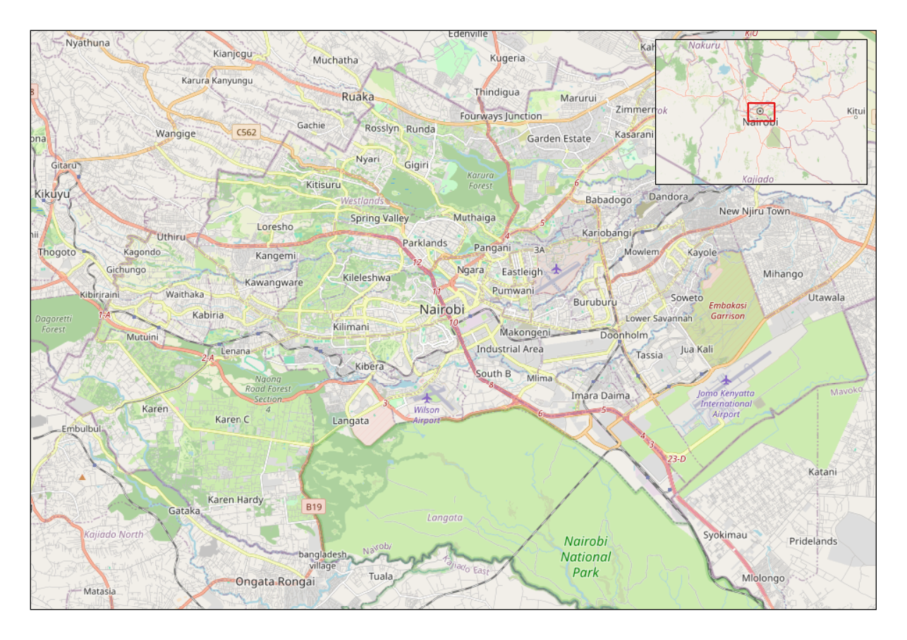
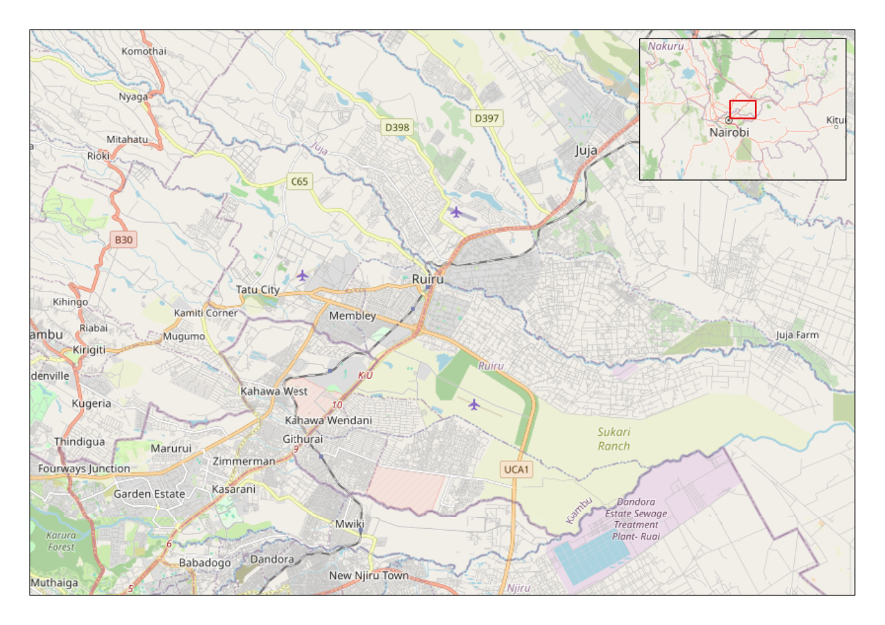
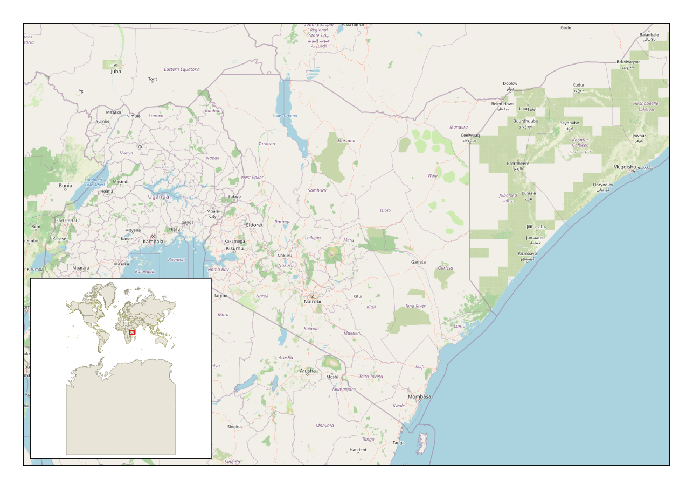
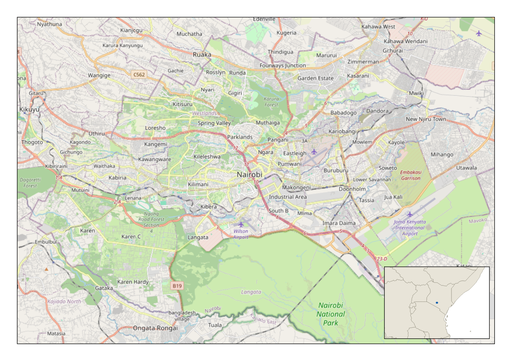

# Quick Inset Map

A QGIS plugin that adds an inset (locator) map to a print layout in one click.

The inset is a small overview map placed in a corner of the main map. It shows
the wider region, draws the main map's extent as a box, and re-centres itself
when the main map is panned or zoomed.

## Screenshots

| | |
|---|---|
|  |  |
| Default settings | After panning the main map, the inset has re-centred |
|  |  |
| Country map with a world locator | City map with a country locator |

## Requirements

- QGIS 3.28 or later, including QGIS 4.x (Qt5 and Qt6 builds).
- No external dependencies.

## Install

### From the QGIS plugin manager

1. In QGIS, open **Plugins > Manage and Install Plugins...**
2. The plugin is published as experimental: on the **Settings** tab, tick
   **Show also Experimental Plugins**.
3. Search for **Quick Inset Map** and click **Install Plugin**.

### From a ZIP file

1. Download `quick_inset_map-<version>.zip` from the
   [releases page](https://github.com/shakurgds/quick-inset-map/releases),
   or build it yourself (see [Build](#build)).
2. In QGIS, open **Plugins > Manage and Install Plugins... > Install from ZIP**,
   pick the file and click **Install Plugin**.

## Use

### From the main QGIS window

1. Click the **Add inset map to layout...** toolbar button, or use
   **Plugins > Quick Inset Map > Add inset map to layout...**
2. If the project has no print layout yet, the plugin offers to create an A4
   landscape layout from the current map view.
3. Choose the layout, the main map and the options, then click **OK**.
   The layout designer opens with the inset in place.

### From the layout designer

Use **Add Item > Add Inset Map...** (also on the designer's actions toolbar).
The dialog opens with the current layout selected.

Adding an inset is a single undo step in the layout.

## Options

| Option | What it does |
|---|---|
| Layout | The print layout to add the inset to. |
| Main map | The map item the inset belongs to. Existing insets are not listed. |
| Corner | Top right (default), top left, bottom right or bottom left of the main map. |
| Size | Inset width as 10 to 50 % of the main map width (default 25 %). |
| Square inset | Make the inset square instead of the same shape as the main map. |
| Inset shows | **Zoomed out from the main map**: the main map's extent widened by the **Zoom out** factor (1.5 to 500, default 8). **Whole extent of a layer**: the extent of the chosen **Extent layer**, grown to include the main map. |
| Inset layers | **Same layers as the main map**, **A map theme**, or **One layer only**. |
| Extent box colour | Outline colour of the box that marks the main map's extent (default red). |
| Draw a frame around the inset | On by default. |

## How the inset stays in sync

- In "zoomed out" mode the inset re-centres on the main map whenever the main
  map's extent changes. The link is saved with the layout item, so it is
  restored when the project is reopened with the plugin enabled.
- In "whole extent of a layer" mode the inset extent is fixed; only the extent
  box moves.
- For global coordinate systems the zoomed-out extent is clipped to the bounds
  of the world.

## Build

`build.ps1` (Windows PowerShell) reads the version from
`quick_inset_map/metadata.txt` and writes `dist/quick_inset_map-<version>.zip`,
the file to upload to plugins.qgis.org or to install with **Install from ZIP**:

```powershell
powershell -ExecutionPolicy Bypass -File .\build.ps1
```

## License

GPL-2.0-or-later. See [LICENSE](LICENSE).
